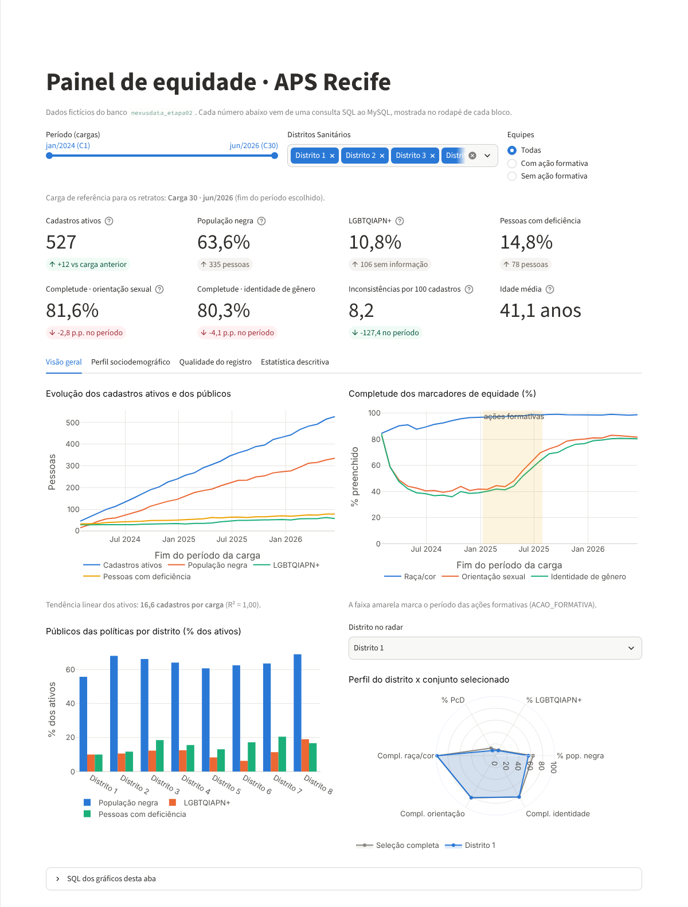
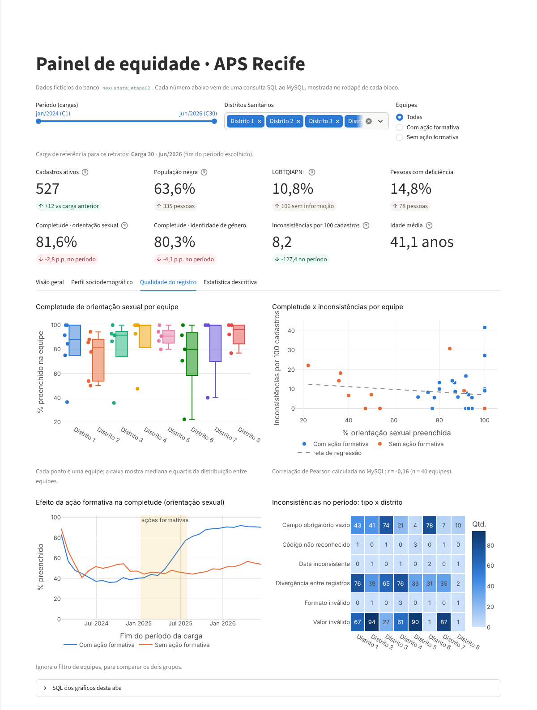
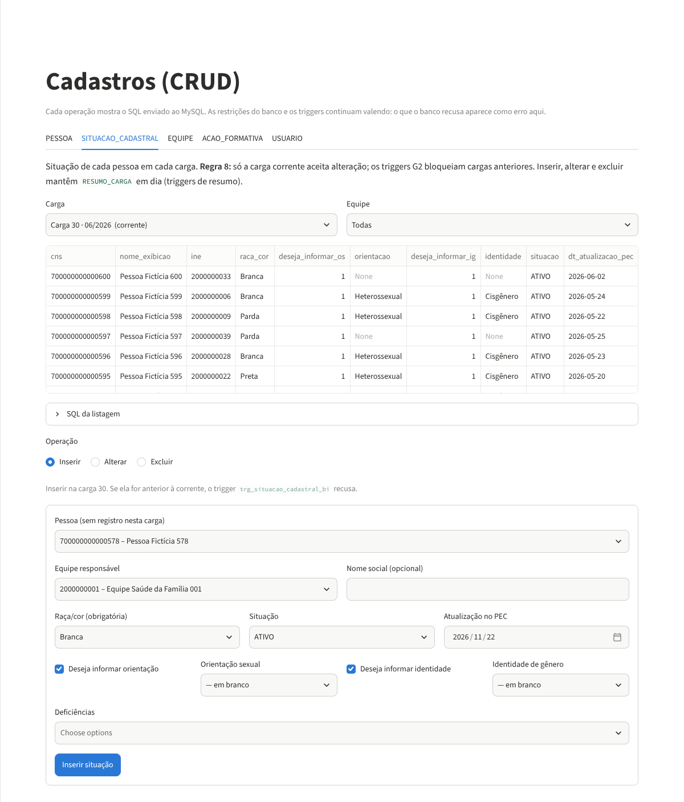

<h1 align="center">🧬 Nexus Data · SGBD</h1>

<p align="center">
  <strong>Banco de dados e painel para o monitoramento de equidade na Atenção Primária à Saúde do Recife</strong>
</p>

<p align="center">
  
  
  
  
</p>

<p align="center">
  <b>Modelagem e Projeto de Banco de Dados · CESAR School · 2026.2 · Equipe Nexus Data</b><br>
  Projeto integrado a <a href="https://github.com/RedAkasha/nexus-data-aps-recife">Projetos 3 – Nexus Data APS Recife</a>
</p>

<p align="center">
  
</p>

---

## Sobre

A Secretaria de Saúde do Recife acompanha três políticas de equidade – **População Negra**, **População LGBTQIAPN+** e **Pessoa com Deficiência** – a partir do cadastro do PEC/e-SUS APS. Este repositório reúne todas as entregas da disciplina: o minimundo e os modelos, o banco MySQL (tabelas, dados, consultas, índices, visões, funções, procedimentos e triggers) e a aplicação final, um painel interativo em Streamlit que lê e grava no banco com SQL explícito.

> **Dados fictícios.** Nenhuma linha corresponde a uma pessoa real. CNS, CPF e nomes são inventados.

## Entregas

| Etapa | Conteúdo | Pasta |
|---|---|---|
| **01** | Minimundo, modelo conceitual (brModelo), modelo lógico, esquema relacional e dicionário de dados | [`etapa01-modelagem`](etapa01-modelagem) |
| **02** | SQL de criação (CHECK, DEFAULT, UNIQUE, CASCADE, SET NULL, sequências) e inserção (≥ 30 tuplas por tabela, exceções justificadas) | [`etapa02-criacao-insercao`](etapa02-criacao-insercao) |
| **03** | Consultas C1–C8, resumo por carga com trigger e visão de evolução; primeira versão da interface | [`etapa03-consultas-interface`](etapa03-consultas-interface) |
| **04** | 3 índices com EXPLAIN antes/depois; consultas com anti join, full outer join e subconsultas (C9–C12); 2 visões com 7 joins | [`etapa04-indices-consultas-visoes`](etapa04-indices-consultas-visoes) |
| **05** | 2 funções com IF/ELSEIF, procedimento de atualização, procedimento com cursor, trigger de log e trigger da regra 8 | [`etapa05-funcoes-procedimentos-triggers`](etapa05-funcoes-procedimentos-triggers) |
| **06** | Aplicação final: CRUD de 5 tabelas, consultas e visões com filtros, integração com funções/procedimentos/triggers, painel estatístico com 13 gráficos | [`etapa06-aplicacao-final`](etapa06-aplicacao-final) · [`app`](app) |

Cada pasta tem um README com o que foi entregue, as justificativas semânticas e onde cada requisito está atendido.

## Estrutura

```
├── etapa01-modelagem/                 minimundo, modelos (PNG), esquema relacional, dicionário de dados
├── etapa02-criacao-insercao/          01_criacao_tabelas.sql · 02_insercao_dados.sql
├── etapa03-consultas-interface/       01_consultas.sql · 02_evolucao_cargas.sql
├── etapa04-indices-consultas-visoes/  01_indices.sql · 02_consultas.sql · 03_visoes.sql
├── etapa05-funcoes-procedimentos-triggers/  01_funcoes.sql · 02_procedimentos.sql · 03_triggers.sql
├── etapa06-aplicacao-final/           01_carga_demonstracao.sql · README com os requisitos
├── app/                               aplicação Streamlit
│   ├── app.py                         navegação
│   ├── db.py                          conexão PyMySQL e execução de SQL
│   ├── sql_consultas.py               SQL das consultas e visões usadas na interface
│   ├── ui.py                          paleta, tema dos gráficos e filtros
│   └── paginas/                       inicio · painel · consultas · cadastros · rotinas
├── scripts/
│   ├── instalar_banco.py              executa todos os .sql na ordem (interpreta DELIMITER)
│   └── gerar_dicionario.py            gera o dicionário de dados a partir do banco
├── docs/img/                          capturas de tela
└── requirements.txt
```

## Como executar

**Pré-requisitos:** MySQL 8.0+ e Python 3.10+.

```bash
# 1. dependências
python -m venv .venv
source .venv/bin/activate            # Windows: .venv\Scripts\activate
pip install -r requirements.txt

# 2. conexão (ou copie .streamlit/secrets.toml.example para .streamlit/secrets.toml)
export NEXUS_DB_USER=root            # Windows (PowerShell): $env:NEXUS_DB_USER="root"
export NEXUS_DB_PASSWORD=sua_senha

# 3. banco: APAGA e recria nexusdata_etapa02 e roda as Etapas 02 a 06 (~5 s)
python scripts/instalar_banco.py --quieto

# 4. aplicação
streamlit run app/app.py
```

Variáveis aceitas: `NEXUS_DB_HOST` (padrão `localhost`), `NEXUS_DB_PORT` (`3306`), `NEXUS_DB_USER` (`root`), `NEXUS_DB_PASSWORD` (vazio), `NEXUS_DB_NAME` (`nexusdata_etapa02`). Sem `--quieto`, o instalador imprime o resultado de cada teste dos scripts. Com `--sem-demo`, instala só os dados da Etapa 02.

**Pelo MySQL Workbench ou DBeaver:** execute os arquivos nesta ordem, cada um inteiro (no DBeaver, *Executar script*, Alt+X, por causa do `DELIMITER`):

1. `etapa02-criacao-insercao/01_criacao_tabelas.sql`
2. `etapa02-criacao-insercao/02_insercao_dados.sql`
3. `etapa03-consultas-interface/01_consultas.sql` e `02_evolucao_cargas.sql`
4. `etapa04-indices-consultas-visoes/01_indices.sql`, `02_consultas.sql`, `03_visoes.sql`
5. `etapa05-funcoes-procedimentos-triggers/01_funcoes.sql`, `02_procedimentos.sql`, `03_triggers.sql`
6. `etapa06-aplicacao-final/01_carga_demonstracao.sql`

Os testes embutidos nos scripts das Etapas 03 a 05 foram escritos para os dados da Etapa 02 (só a carga 1); depois da carga de demonstração, a carga corrente passa a ser a 30.

## A aplicação

| Página | O que faz |
|---|---|
| **Início** | Resumo do projeto, contagem de registros por tabela e os modelos |
| **Painel** | 8 indicadores e 13 gráficos (linhas, barras, rosca, radar, pirâmide, histograma, boxplot, dispersão com correlação, mapa de calor) com filtros de período, distrito e equipes com/sem ação formativa; estatística descritiva calculada no MySQL |
| **Consultas e visões** | C1–C12 e as três visões, com parâmetros, gráfico, tabela, CSV e o SQL executado |
| **Cadastros (CRUD)** | Inserir, alterar, excluir e listar em `PESSOA`, `SITUACAO_CADASTRAL`, `EQUIPE`, `ACAO_FORMATIVA` e `USUARIO`; erros de CHECK, UNIQUE, FK e triggers aparecem explicados |
| **Funções, procedimentos e triggers** | Executa F1, F2, P1, P2 (cursor) e P3; mostra o log do G1 e testa cada caso da regra 8 |

<p align="center">
  
  
</p>

## O que mudou na consolidação final

* **Correção na `VW_EVOLUCAO_CARGAS` (Etapa 03):** subtrair colunas `UNSIGNED` gerava o erro 1690 sempre que uma carga tinha menos ativos que a anterior. A visão agora converte para `SIGNED`.
* **Regra 8 completa (Etapa 05):** além de UPDATE/DELETE, os triggers passaram a bloquear INSERT em carga anterior e alterações nas deficiências de cargas anteriores – portas que o CRUD abriria.
* **Resumo sempre coerente (Etapa 05):** procedimento `sp_recalcular_resumo_carga` e triggers que recalculam o resumo após UPDATE/DELETE e mudança de duplicidade.
* **Etapa 01 completa:** minimundo integral, esquema relacional e dicionário de dados gerado do banco.
* **Etapa 04 criada:** índices, consultas C9–C12 e duas visões.
* **Carga de demonstração (Etapa 06):** cargas 2 a 30 com 600 pessoas, geradas pelos caminhos do próprio banco.
* Arquivos SQL com finais de linha LF, cabeçalhos padronizados e um único formato (com `DELIMITER`) para todos os scripts.

## Equipe

| Integrante | E-mail |
|---|---|
| Filipe Nava | [fon2@cesar.school](mailto:fon2@cesar.school) |
| Leandro Tavarez | [lsgt@cesar.school](mailto:lsgt@cesar.school) |
| Hallana Santana | [hso3@cesar.school](mailto:hso3@cesar.school) |

CESAR School – Modelagem e Projeto de Banco de Dados, 2026.2.
