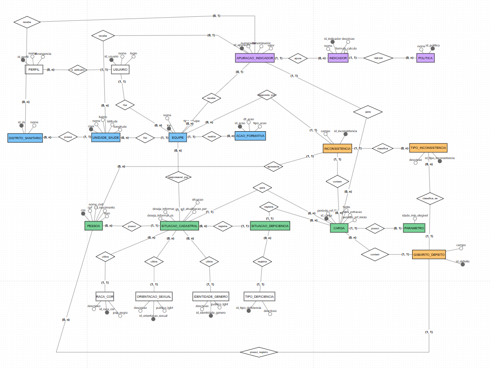
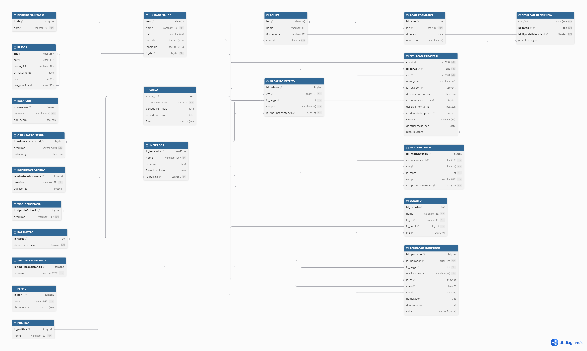

# Etapa 01 – Minimundo, modelo conceitual e modelo lógico

| Entregável | Onde está |
|---|---|
| Definição do minimundo (descrição completa) | [abaixo](#1-minimundo) · PDF original em [`descricao_minimundo.pdf`](descricao_minimundo.pdf) |
| Imagem do esquema conceitual (brModelo) | [`modelo_conceitual.png`](modelo_conceitual.png) |
| Imagem do esquema lógico | [`modelo_logico.png`](modelo_logico.png) |
| Esquema relacional | [abaixo](#4-esquema-relacional) |
| Tabela do dicionário de dados | [`dicionario_dados.md`](dicionario_dados.md) |

---

## 1. Minimundo

**Monitoramento de Equidade em Saúde na APS do Recife** – Equipe Nexus Data

### 1.1 Contexto
A Secretaria de Saúde do Recife gere o SUS no município. A população é cadastrada e acompanhada na Atenção Primária à Saúde (APS) pelo sistema PEC/e-SUS APS. A Secretaria mantém três políticas de equidade: Saúde Integral da População LGBTQIAPN+, Atenção Integral à Saúde da Pessoa com Deficiência e Saúde Integral da População Negra. Elas precisam conhecer o perfil das pessoas acompanhadas e sua distribuição no território para planejar, monitorar e avaliar suas ações.

### 1.2 Território
O município tem 8 Distritos Sanitários, numerados de 1 a 8. Cada distrito reúne várias Unidades de Saúde da Família (141 no total), cada uma pertencente a um único distrito, identificada pelo código CNES e com nome, bairro, latitude e longitude. Cada unidade abriga uma ou mais Equipes de Saúde da Família (384 no total), cada uma pertencente a uma única unidade, identificada pelo código INE e com nome. As equipes cadastram e acompanham a população do seu território.

### 1.3 Pessoas cadastradas
Cada pessoa é identificada pelo Cartão Nacional de Saúde (CNS), tem CPF opcional e está vinculada a exatamente uma equipe. Registram-se nome civil, nome social (opcional), data de nascimento, sexo e raça/cor (obrigatória). Identidade de gênero e orientação sexual são voluntárias e podem ficar em branco ou como "não deseja informar". A pessoa pode ter nenhuma, uma ou várias deficiências (auditiva, visual, física, intelectual ou outra). Idade e faixa etária são calculadas a partir da data de nascimento e não são armazenadas.

Os campos de classificação aceitam apenas as categorias do cadastro do PEC/e-SUS APS. Só entram na contagem pessoas com cadastro ativo; óbitos, mudanças de território e duplicidades são excluídos, e o cadastro duplicado conta uma vez.

### 1.4 Públicos das políticas
Uma pessoa pode pertencer a mais de um público. **População negra:** raça/cor preta ou parda. **Pessoa com deficiência:** ao menos uma deficiência registrada. **População LGBTQIAPN+:** identidade de gênero diferente de cisgênero ou orientação sexual diferente de heterossexual; quem não informou esses campos é contabilizado à parte, como "sem informação". As análises sociodemográficas usam sexo, faixa etária, raça/cor e território.

### 1.5 Extrações e qualidade do registro
Os dados são extraídos do PEC/e-SUS APS periodicamente. Cada extração (carga) tem data e hora e um período de referência, e guarda a situação cadastral de cada pessoa naquele período, o que permite acompanhar a evolução no tempo e por território. Registros de períodos anteriores não podem ser alterados.

Raça/cor, apesar de obrigatória, pode vir vazia ou inconsistente. A cada carga identificam-se as inconsistências (campo obrigatório vazio, valor inválido ou divergência entre registros), guardando-se a pessoa, o campo, o tipo e a carga. Cada inconsistência fica associada à equipe responsável pelo cadastro. Para os campos opcionais, a ausência de resposta não é inconsistência, mas entra no cálculo da completude por território.

### 1.6 Indicadores e usuários
A gestão precisa saber: quantas pessoas de cada público estão cadastradas e como se distribuem por distrito, unidade e equipe; o perfil por identidade de gênero, orientação sexual, nome social, faixa etária e raça/cor; a distribuição por tipo de deficiência; e a completude e a consistência dos marcadores de equidade. Cada indicador tem nome, descrição, política, forma de cálculo e é apurado por período e por nível territorial.

As informações são consultadas pelas coordenações das políticas, por gestores municipais e pelas equipes da APS. Cada usuário tem um perfil que define o que pode ver: a equipe vê só o seu território, e as coordenações veem todo o município.

### 1.7 Regras de negócio
1. Toda unidade pertence a um distrito, e toda equipe pertence a uma unidade.
2. Não existe pessoa cadastrada sem equipe.
3. Raça/cor é obrigatória; identidade de gênero e orientação sexual são opcionais.
4. Os campos de classificação só aceitam os valores permitidos.
5. Só cadastros ativos entram na contagem, e duplicidades contam uma vez.
6. Os indicadores são agregados e não identificam a pessoa (LGPD); em listagens nominais restritas às equipes usa-se o nome social, quando existir.
7. Toda inconsistência está vinculada a uma carga e à equipe responsável.
8. Registros de períodos anteriores não podem ser alterados.
9. O acesso às informações segue o perfil do usuário.

### 1.8 Escopo
Ficam fora do escopo os dados clínicos, a edição dos registros originais do PEC/e-SUS APS e os indicadores de acesso e cuidado em saúde (como frequência de atendimentos), que dependem de dados de atendimento e ficam para uma etapa futura.

---

## 2. Modelo conceitual (brModelo)

Entidades principais: **DISTRITO_SANITARIO → UNIDADE_SAUDE → EQUIPE** (território), **PESSOA** e sua **SITUACAO_CADASTRAL** em cada **CARGA** (com **SITUACAO_DEFICIENCIA**), as tabelas de domínio do PEC (**RACA_COR**, **ORIENTACAO_SEXUAL**, **IDENTIDADE_GENERO**, **TIPO_DEFICIENCIA**), a qualidade do registro (**INCONSISTENCIA**, **TIPO_INCONSISTENCIA**, **GABARITO_DEFEITO**), os indicadores (**POLITICA → INDICADOR → APURACAO_INDICADOR**) e o acesso (**PERFIL → USUARIO**).

Decisões de modelagem que valem para todo o projeto:

* **A situação cadastral é separada da pessoa.** PESSOA guarda o que não muda entre extrações (CNS, nascimento, sexo); SITUACAO_CADASTRAL guarda o retrato da pessoa em cada carga (equipe, marcadores, situação). É isso que permite comparar cargas e congelar períodos anteriores (regra 8).
* **Duplicidade como autorrelacionamento.** `PESSOA.cns_principal` aponta para o cadastro que vale; o duplicado continua no banco, mas sai das contagens (regra 5).
* **Domínios com atributos de política.** `RACA_COR.pop_negra` e `publico_lgbt` em orientação/identidade dizem quem pertence a cada público; uma categoria nova do PEC entra no domínio sem mudar o código.
* **Idade não é armazenada:** é calculada no fim do período da carga (`CARGA.periodo_ref_fim`).

## 3. Modelo lógico

## 4. Esquema relacional

Notação: **chave primária** em negrito, *chave estrangeira* em itálico (***negrito e itálico*** = faz parte da PK e é FK); `?` indica coluna opcional (NULL). Abaixo de cada relação, a tabela referenciada por cada FK.

- **DISTRITO_SANITARIO** ( **id_ds**, nome )
- **UNIDADE_SAUDE** ( **cnes**, nome, bairro, latitude?, longitude?, *id_ds* )
  - FK `id_ds → DISTRITO_SANITARIO(id_ds)`
- **EQUIPE** ( **ine**, nome, tipo_equipe, *cnes* )
  - FK `cnes → UNIDADE_SAUDE(cnes)`
- **ACAO_FORMATIVA** ( **id_acao**, *ine*, dt_acao, tipo_acao )
  - FK `ine → EQUIPE(ine)`
- **PESSOA** ( **cns**, cpf?, nome_civil, dt_nascimento, sexo, *cns_principal*? )
  - FK `cns_principal → PESSOA(cns)`
- **CARGA** ( **id_carga**, dt_hora_extracao, periodo_ref_inicio, periodo_ref_fim, fonte )
- **RACA_COR** ( **id_raca_cor**, descricao, pop_negra )
- **ORIENTACAO_SEXUAL** ( **id_orientacao_sexual**, descricao, publico_lgbt )
- **IDENTIDADE_GENERO** ( **id_identidade_genero**, descricao, publico_lgbt )
- **TIPO_DEFICIENCIA** ( **id_tipo_deficiencia**, descricao )
- **SITUACAO_CADASTRAL** ( ***cns***, ***id_carga***, *ine*, nome_social?, *id_raca_cor*, deseja_informar_os, *id_orientacao_sexual*?, deseja_informar_ig, *id_identidade_genero*?, situacao, dt_atualizacao_pec )
  - FK `cns → PESSOA(cns)`
  - FK `id_carga → CARGA(id_carga)`
  - FK `ine → EQUIPE(ine)`
  - FK `id_raca_cor → RACA_COR(id_raca_cor)`
  - FK `id_orientacao_sexual → ORIENTACAO_SEXUAL(id_orientacao_sexual)`
  - FK `id_identidade_genero → IDENTIDADE_GENERO(id_identidade_genero)`
- **SITUACAO_DEFICIENCIA** ( ***cns***, ***id_carga***, ***id_tipo_deficiencia*** )
  - FK `(cns, id_carga) → SITUACAO_CADASTRAL(cns, id_carga)`
  - FK `id_tipo_deficiencia → TIPO_DEFICIENCIA(id_tipo_deficiencia)`
- **PARAMETRO** ( ***id_carga***, idade_min_elegivel )
  - FK `id_carga → CARGA(id_carga)`
- **TIPO_INCONSISTENCIA** ( **id_tipo_inconsistencia**, descricao )
- **INCONSISTENCIA** ( **id_inconsistencia**, *ine_responsavel*, *cns*, *id_carga*, campo, *id_tipo_inconsistencia* )
  - FK `ine_responsavel → EQUIPE(ine)`
  - FK `cns → PESSOA(cns)`
  - FK `id_carga → CARGA(id_carga)`
  - FK `id_tipo_inconsistencia → TIPO_INCONSISTENCIA(id_tipo_inconsistencia)`
- **GABARITO_DEFEITO** ( **id_defeito**, *cns*, *id_carga*, campo, *id_tipo_inconsistencia* )
  - FK `cns → PESSOA(cns)`
  - FK `id_carga → CARGA(id_carga)`
  - FK `id_tipo_inconsistencia → TIPO_INCONSISTENCIA(id_tipo_inconsistencia)`
- **PERFIL** ( **id_perfil**, nome, abrangencia )
- **USUARIO** ( **id_usuario**, nome, login, *id_perfil*, *ine*? )
  - FK `id_perfil → PERFIL(id_perfil)`
  - FK `ine → EQUIPE(ine)`
- **POLITICA** ( **id_politica**, nome )
- **INDICADOR** ( **id_indicador**, nome, descricao, formula_calculo, *id_politica* )
  - FK `id_politica → POLITICA(id_politica)`
- **APURACAO_INDICADOR** ( **id_apuracao**, *id_indicador*, *id_carga*, nivel_territorial, *id_ds*?, *cnes*?, *ine*?, numerador, denominador, valor? )
  - FK `id_indicador → INDICADOR(id_indicador)`
  - FK `id_carga → CARGA(id_carga)`
  - FK `id_ds → DISTRITO_SANITARIO(id_ds)`
  - FK `cnes → UNIDADE_SAUDE(cnes)`
  - FK `ine → EQUIPE(ine)`

Tabelas acrescentadas nas etapas seguintes (não fazem parte do modelo de negócio, mas estão no dicionário):

- **RESUMO_CARGA** ( ***id_carga***, total_registros, total_ativos, total_negros_ativos, total_lgbt_ativos, dt_processamento ) — _Etapa 03_
  - FK `id_carga → CARGA(id_carga)`
- **LOG_ALTERACAO_PESSOA** ( **id_log**, cns, campo, valor_anterior?, valor_novo?, usuario_bd, dt_hora_alteracao ) — _Etapa 05 (sem FK, de propósito)_

## 5. Dicionário de dados

O dicionário completo, com tipo, nulidade, chaves, valores padrão, restrições CHECK e regras de FK de cada coluna, está em **[`dicionario_dados.md`](dicionario_dados.md)**. Ele é gerado a partir do banco instalado (`python scripts/gerar_dicionario.py`), então nunca fica diferente do SQL da Etapa 02.
