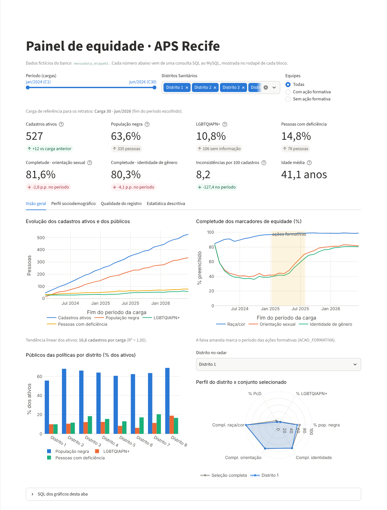
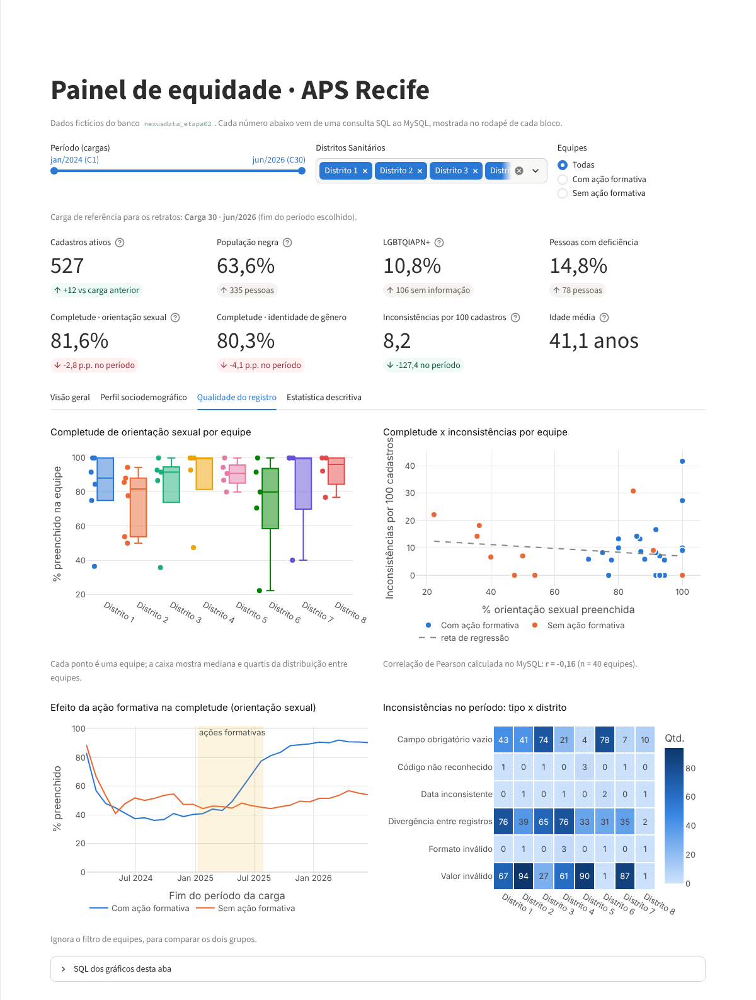
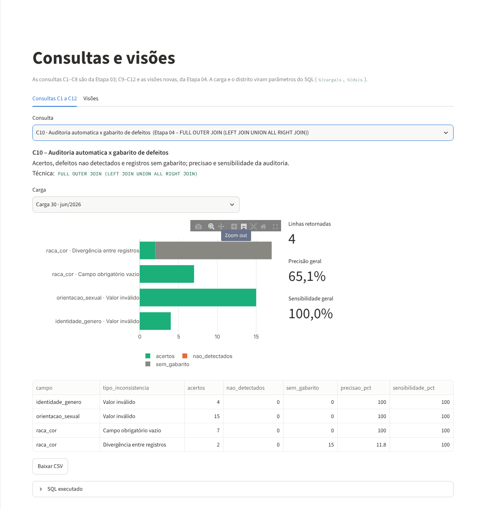
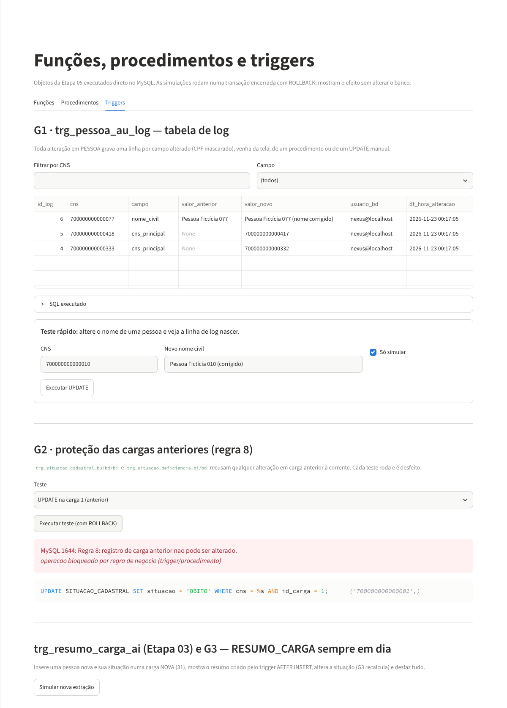

# Etapa 06 – Aplicação final integrada ao banco

Versão definitiva da aplicação ([`../app`](../app)): Streamlit + Python, conversando com o MySQL por **SQL explícito** (PyMySQL, sem ORM). Cada tela mostra o SQL que executou.

| Arquivo | Conteúdo |
|---|---|
| [`01_carga_demonstracao.sql`](01_carga_demonstracao.sql) | Preenche as cargas 2 a 30 (600 pessoas fictícias) pelos caminhos normais do banco, para o painel ter série temporal e distribuição |
| [`../app/`](../app) | Aplicação (páginas em `app/paginas/`, SQL das consultas em `app/sql_consultas.py`, acesso ao banco em `app/db.py`) |

## Requisitos × onde estão

### CRUD em ao menos 4 tabelas → página **Cadastros (CRUD)**: 5 tabelas
| Tabela | Inserir | Alterar | Excluir | O que a tela demonstra |
|---|:-:|:-:|:-:|---|
| `PESSOA` | ✓ | ✓ | ✓ | CHECK do CNS, UNIQUE do CPF, log do trigger G1 a cada alteração, RESTRICT ao excluir pessoa com histórico |
| `SITUACAO_CADASTRAL` (+ `SITUACAO_DEFICIENCIA`) | ✓ | ✓ | ✓ | Regra 8: carga anterior é recusada pelos triggers; resumo atualizado pelos triggers de resumo; deficiências na mesma transação |
| `EQUIPE` | ✓ | ✓ | ✓ | CHECK do tipo, **ON UPDATE CASCADE** ao trocar o INE, **ON DELETE SET NULL** em `USUARIO.ine`, RESTRICT |
| `ACAO_FORMATIVA` | ✓ | ✓ | ✓ | AUTO_INCREMENT; muda o grupo com/sem ação do painel e da C9 |
| `USUARIO` | ✓ | ✓ | ✓ | UNIQUE do login, FK opcional para equipe |

### Integração com funções, procedimentos e triggers → página **Funções, procedimentos e triggers**
* **F1** `fn_faixa_etaria`: calculadora com datas + distribuição por faixa numa carga; usada também na pirâmide e na tabela de frequências do painel.
* **F2** `fn_classifica_publico_lgbt`: matriz de todas as combinações dos domínios.
* **P1** `sp_marcar_cadastro_duplicado`: formulário com resumo antes/depois e as linhas de log geradas; validações do procedimento aparecem como erro.
* **P2** `sp_auditar_inconsistencias_carga` (cursor): escolha da carga e modo *Simular (ROLLBACK)* ou *Gravar (COMMIT)*.
* **P3** `sp_recalcular_resumo_carga`.
* **G1**: consulta filtrável de `LOG_ALTERACAO_PESSOA` e teste rápido de UPDATE.
* **G2**: cinco testes da regra 8 (UPDATE, DELETE, INSERT em carga anterior, mover de carga, e o caso permitido).
* **trg_resumo_carga_ai + G3**: simulação de uma extração nova (carga 31) com o resumo criado e recalculado, tudo desfeito no fim.

### Consultas e views acessíveis, com filtros e visual → página **Consultas e visões**
* C1–C8 (Etapa 03) e C9–C12 (Etapa 04), cada uma com **parâmetro de carga** e, quando faz sentido, **de distrito**; gráfico, métricas, tabela, download CSV e o SQL.
* `VW_EVOLUCAO_CARGAS` (intervalo de cargas, variação com sinal), `VW_PERFIL_EQUIDADE_EQUIPE` (carga e distrito, gráfico de bolhas por equipe) e `VW_LISTA_NOMINAL_INCONSISTENCIAS` com **"Ver como"**: escolhendo um usuário de perfil *Equipe APS*, a lista fica restrita ao território dele (regra 9).

### Dashboard estatístico integrado → página **Painel**
Tudo calculado sobre os dados do banco, com **filtros de período (intervalo de cargas), distritos e equipes com/sem ação formativa**.

**Indicadores resumidos (8):** cadastros ativos (variação sobre a carga anterior), % população negra, % LGBTQIAPN+ (e quantos sem informação), % pessoas com deficiência, completude de orientação sexual e de identidade de gênero (variação no período), inconsistências por 100 cadastros, idade média.

**Gráficos dinâmicos (13):**

| Aba | Gráfico | Análise estatística |
|---|---|---|
| Visão geral | Linhas – evolução de ativos e dos três públicos | tendência temporal + reta de regressão (inclinação e R²) |
| Visão geral | Linhas – completude dos marcadores, com a faixa das ações formativas | tendência temporal |
| Visão geral | Barras agrupadas – públicos por distrito | comparação de proporções |
| Visão geral | Radar – distrito × conjunto selecionado | perfil multivariado |
| Perfil | Rosca – raça/cor | distribuição de frequência |
| Perfil | Pirâmide etária por sexo (faixas da F1) | distribuição conjunta |
| Perfil | Histograma de idades com média, mediana e moda | medidas de posição |
| Perfil | Barras empilhadas – deficiência por tipo e distrito | frequências |
| Qualidade | Boxplot – completude por equipe em cada distrito | dispersão, quartis, outliers |
| Qualidade | Dispersão – completude × inconsistências por equipe | **correlação de Pearson calculada no MySQL** + reta de regressão |
| Qualidade | Linhas – com × sem ação formativa | comparação de grupos no tempo |
| Qualidade | Mapa de calor – tipo de inconsistência × distrito | tabela de contingência |
| Estatística | Barras + linha – frequência relativa e acumulada por faixa | distribuição de frequências |

**Estatística descritiva no MySQL:** n, média, mediana (função de janela), moda, variância, desvio-padrão, coeficiente de variação, mínimo, quartis e máximo para cinco variáveis (idade, ativos por equipe, completudes por equipe, inconsistências por 100).

## Por que uma carga de demonstração
Com os dados da Etapa 02, só a carga 1 tinha registros (60 pessoas): não havia tendência no tempo nem equipes com tamanho para boxplot ou correlação. O script gera as cargas 2 a 30 de forma determinística e **pelos caminhos do próprio banco**: insere carga a carga (o trigger da Etapa 03 alimenta o resumo e a regra 8 é respeitada), roda a auditoria com cursor em cada carga, registra o gabarito dos defeitos plantados e faz uma pequena curadoria com o P1. A simulação reproduz raça/cor com maioria parda, preenchimento dos campos voluntários que melhora depois das ações formativas de 2025, recusas e registros inválidos, deficiência mais frequente em idosos, óbitos e transferências. A carga 1 da Etapa 02 não é alterada.

## Telas

